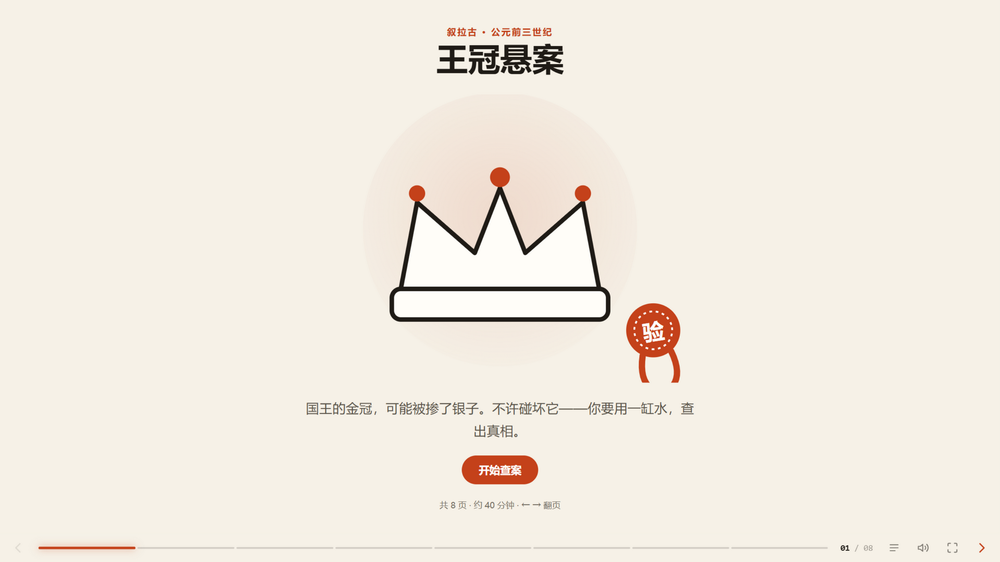

# 互动教学课件生成器（interactive-courseware）

把一节课的讲义交给 AI，还你一套能直接上课的网页课件。

> **在线预览**：<https://liangdabiao.github.io/interactive-courseware/> —— 两个示例课件（阿基米德与浮力 / 勾股定理双证记）可直接在浏览器里试玩，由 `docs/` 目录经 GitHub Pages 发布。

## 这是什么

这是一个 AI 编程工具（ZCode、Claude Code 等）的 **skill（技能包）**。装好之后，你只需要说一句：

> 这是《阿基米德与浮力》一节课的讲义，帮我做成互动课件

AI 就会走完一套专业流程，最后交付一个文件夹：

```
你的课件/
├── page-01.html … page-08.html   # 每一页是一个独立的网页
├── index.html                     # 播放器：方向键翻页、进度条、目录、全屏、静音
└── 课件.html                      # 打包成的单文件版，发给别人双击就能打开
```

这套课件有两种用法：老师在教室里用投影或触控一体机带着全班上课（三米外看得清、手指点得准），学员也能在电脑、平板、手机上自己翻着学。

## 快速开始

1. 把 `​.agents/skills/interactive-courseware/` 整个文件夹复制到你项目的同一路径下（`<你的项目>/.agents/skills/interactive-courseware/`）。
2. 打开 AI 编程工具，把讲义内容给它，说"做成互动课件"。
3. AI 会先给你一份《课件设计蓝图》（两三分钟就能读完）：学员是谁、整节课包装成什么故事、做几个游戏、用哪组配色、每页讲什么。你确认或提修改。
4. 确认后 AI 一口气生成全部页面、装进播放器、打包成单文件，并在浏览器里把每个互动都点一遍。

## 一个完整的例子

[`examples/archimedes-buoyancy/`](examples/archimedes-buoyancy/) 是用这套方法做出的整节课——《阿基米德与浮力》：8 页互动课件，讲阿基米德用一缸水破"王冠掺银"悬案。里面的 `课件.html` 双击就能上课；想改哪页，直接改对应的 `page-xx.html`，再跑一次 `python pack.py`。



更多截图在 [`examples/archimedes-buoyancy/screenshots/`](examples/archimedes-buoyancy/screenshots/)：实验台拖拽、开闸验证、破案推理链。

## 不用 AI，手工也能做

三件套都在仓库里，流程和上面完全一样：

| 文件 | 是什么 | 怎么用 |
|---|---|---|
| `assets/page-template.html` | 页面骨架 | 每页复制一份，只写"本页样式 / 本页内容 / 本页脚本"三段 |
| `assets/player.html` | 播放器外壳 | 复制成 index.html，只改里面的 `DECK`（课程名、三个颜色、页面清单） |
| `scripts/pack.py` | 打包脚本 | 在课件文件夹里运行 `python pack.py`，所有页面内嵌成一个 课件.html |

具体的设计讲究都写在 [`SKILL.md`](.agents/skills/interactive-courseware/SKILL.md) 里——它是写给 AI 看的操作手册，人也能直接读。

## 这套方法讲究什么

最核心的几条：

- **页面只放内容** —— 标题栏、页码、进度条、翻页按钮全部由播放器提供，页面里不重复画。
- **一屏一页，主体要大** —— 横屏不滚动，图示和互动区撑满屏幕，所有尺寸用 rem 跟着屏幕等比缩放。
- **全课只有一种强调色** —— 一个底色 + 一种强调色 + 黑白灰文字，颜色越少越高级。
- **游戏机制 = 知识点的思维动作** —— 游戏里反复做的那个动作，正是这节课要亲手练会的能力；不是这种知识点就不硬塞游戏。
- **3D 默认不用** —— 只有立体结构、空间关系非 3D 不可时才用，一节课不超过两三页。
- **老师随时能跳页** —— 游戏不锁翻页，公开课上不怕被某一页卡住。

## 工作流程（三阶段）

**① 设计蓝图** → **② 生成页面** → **③ 装进播放器**

蓝图包含六部分：课情判断、创意概念（整节课包装成什么故事）、玩法判断（做几个游戏、各练什么）、3D 判断、配色气质、页面序列表（每页的目标、机制、版式、记忆点）。蓝图确认后才会动工，方向错了不用返工。

## 目录结构

```
.agents/skills/interactive-courseware/
├── SKILL.md                  # 技能主文件：触发条件 + 完整工作流 + 设计准则
├── assets/
│   ├── player.html           # 附一：播放器外壳（固定代码，一字不改）
│   └── page-template.html    # 附二：页面骨架（固定代码）
└── scripts/
    └── pack.py               # 附三：打包脚本（固定代码）
```

## 特别感谢

社区支持： https://linux.do

参考文章 ： https://mp.weixin.qq.com/s/1aVZqBSpDuNGqiPPPpXijA